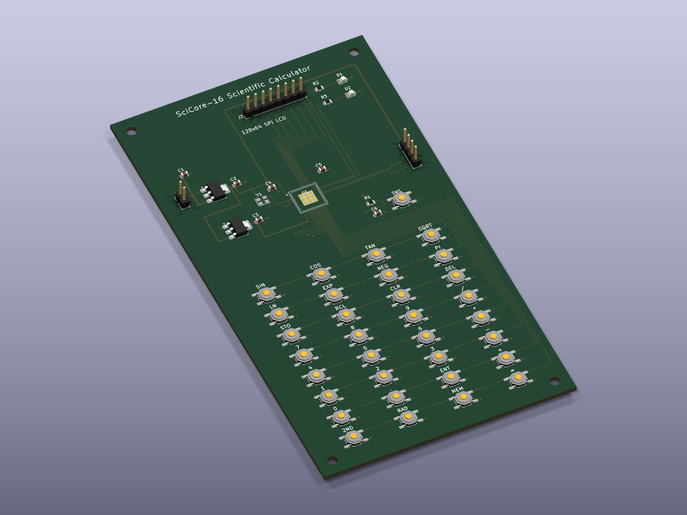
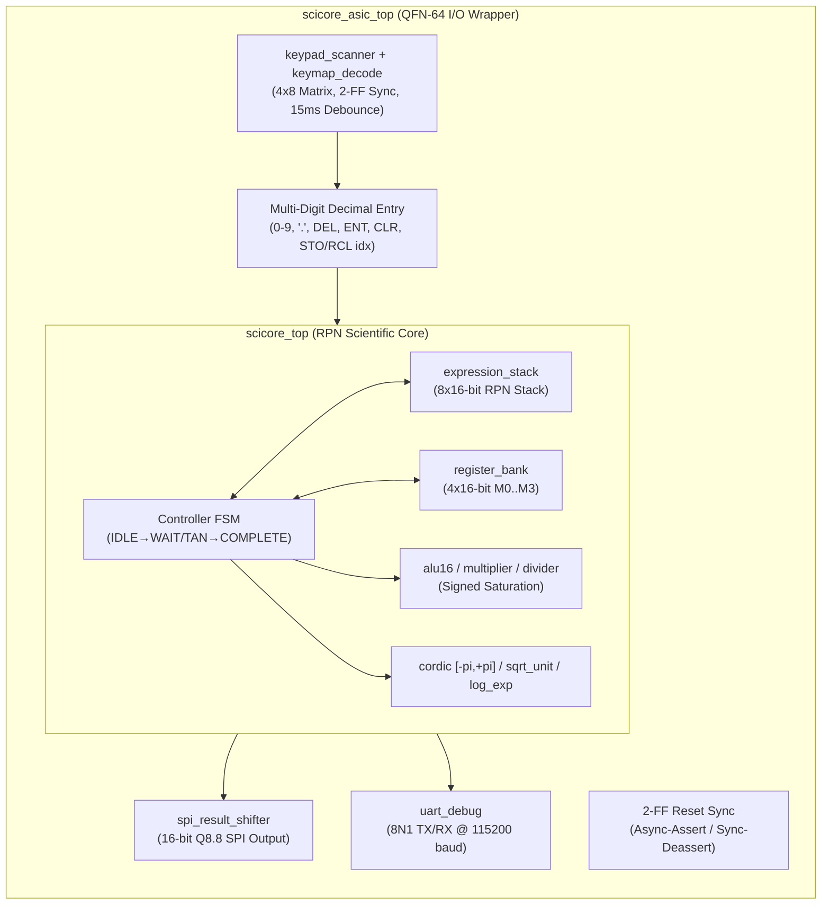

# SciCore-16 (v2.1) — Custom Scientific Calculator ASIC & 2-Layer Handheld PCB

A complete **RTL-to-GDSII digital ASIC** (`scicore_top` core macro on SkyWater SKY130HD 130 nm) and **custom 2-layer KiCad 10 handheld PCB** (`85 × 155 mm`, 32 tactile keys `K1–K32`) implementing a 16-bit signed Q8.8 fixed-point RPN scientific calculator, verified with **Icarus Verilog**, **Verilator (`-Wall`)**, **Yosys**, **OpenROAD Flow Scripts (SKY130HD)**, **KiCad 10 CLI**, and **ngspice-42**.

> **Project Status & Limitations:** Educational ASIC physical-design and PCB engineering project. No silicon fabrication, foundry signoff, or lab-characterized chip is claimed. All metrics below are generated directly from committed scripts and logs in this repository; items not executed locally are explicitly marked **`NOT VERIFIED`**.

---

## Visual Showcase

### 3D Handheld Calculator PCB (`85 × 155 mm`, 32 Keys, KiCad 10 Raytraced)
| Isometric 3D View | Top 3D View (32-Key Matrix) | Bottom 3D View (`B.Cu` GND & `ROW0–3`) |
| :---: | :---: | :---: |
|  |  |  |

### SKY130HD 130 nm Routed ASIC Layout (OpenROAD — `physical_design/6_final.gds`)


### SiliconForge SCMOS Block Layout (`alu16.mag` — 0 DRC, LVS Matched)


### Full-Chip IC Architecture (`scicore_asic_top`)


---

## Architecture Overview (v2.1)



### Key v2.1 Audit Fixes (`AUDIT_RESPONSE.md`)
- **CORDIC `[-π, +π]` range safety (`rtl/arithmetic/cordic.v`):** Added quadrant folding (`sin(π-x)=sin(x)`, `cos(π-x)=-cos(x)`) and `domain_err` for `|θ| > π` (`0x0324`), reducing full-domain error to **`<= 0.83 LSB`**.
- **High-accuracy EXP (`rtl/arithmetic/log_exp.v`):** Upgraded to 14-bit `log2(e)` (`5909/4096`), sign-magnitude 30-bit product (eliminating negative truncation bias), 32-entry Q2.14 LUT with linear interpolation, and round-to-nearest output shift (**`0.180%`** max relative error for `>= 1.0`, **`0.51 LSB`** max absolute error for `< 1.0`).
- **Explicit error & saturation policy (`rtl/top/scicore_top.v`):** Overflow in `ADD`/`SUB`/`NEG`/`MUL`/`DIV`/`EXP` saturates to `0x7FFF`/`0x8000` while setting `err_ovf`; `div_zero`, `domain_err`, `stack_overflow`, and `stack_underflow` leave the RPN stack **unchanged**.
- **Full 16-opcode map (`integration/opcodes.csv`):** Added `0xE = TAN` (micro-sequenced `CORDIC → DIV`) and `0xF = PUSH_PI` (`0x0324`); `STO`/`RCL` register index comes from the user digit key (`M0..M3`).
- **Single-source-of-truth keymap (`integration/keymap.csv` → `scripts/gen_keymap.py` → `rtl/input/keymap_decode.v`):** CI-verified 1-to-1 match with all 32 PCB switches `K1–K32`.
- **Honest I/O peripherals:**
  - `rtl/output/spi_result_shifter.v`: Shifts the raw 16-bit Q8.8 result over SPI (`disp_clk`, `disp_mosi`, `disp_cs`, `disp_dc`, `disp_rst`, `disp_bl`) to an external display bridge/MCU. *(A standalone 128×64 ST7567 framebuffer/font controller is intentionally not implemented on-die.)*
  - `rtl/output/uart_debug.v`: Full 8N1 UART TX (`115200` baud @ `10 MHz`, transmitting `"XXXX E\r\n"`) and 2-FF synchronized 8N1 RX receiver.
- **PCB & Power Simulation:** Removed obsolete `J2` header, fixed `D1`/`D2` LED polarity (180° forward-biased), assigned `H1–H4` board-only mounting holes, synced BOM/Schematic/PCB (51 components), added `330 Ω` (`5.45 mA`) bleed resistor to `power_network.cir` for AMS1117-1.8 minimum load, and committed real `ngspice-42` + `kicad-cli` reports.

---

## Command Protocol (`integration/opcodes.csv`)

RPN stack commands on `cmd_op[3:0]` (pulsed with `cmd_valid = 1` when `busy == 0`; `result` and `err_flags[4:0]` = `{stack_overflow, stack_underflow, div_zero, domain_err, arith_overflow}` are valid when `done == 1`):

| `cmd_op` | Mnemonic | Arity | Error Policy | Description |
| :---: | :--- | :---: | :--- | :--- |
| `0x0` | `PUSH` | `0 → 1` | Stack unchanged on `stack_ovf` | Push `cmd_imm[15:0]` onto stack |
| `0x1` | `CLEAR` | `N → 0` | Clears all error flags | Reset stack pointer & error flags |
| `0x2` / `0x3` | `ADD` / `SUB` | `2 → 1` | Saturate (`0x7FFF`/`0x8000`) on `ovf` | Signed Q8.8 `nos ± tos` |
| `0x4` / `0x5` | `MUL` / `DIV` | `2 → 1` | Saturate on `ovf`; stack unchanged on `div_zero` | 16-cyc `nos * tos` / 24-cyc `nos / tos` |
| `0x6` | `NEG` | `1 → 1` | Saturate `-128.0 → +127.996` on `ovf` | Signed negate `-tos` |
| `0x7` | `SQRT` | `1 → 1` | Stack unchanged on `domain_err` (`tos < 0`) | 12-cyc restoring `sqrt(tos)` |
| `0x8` / `0x9` | `SIN` / `COS` | `1 → 1` | Stack unchanged on `domain_err` (`|tos| > π`) | 12-iter CORDIC over `[-π, +π]` |
| `0xA` / `0xB` | `LN` / `EXP` | `1 → 1` | Stack unchanged on `ln(<=0)`; saturate `exp` ovf | Piecewise-linear LUT `ln` / 32-LUT `exp` |
| `0xC` / `0xD` | `STO` / `RCL` | `1→1` / `0→1` | Stack unchanged on `udf`/`ovf` | Store/Recall `M[cmd_imm[1:0]]` |
| `0xE` | `TAN` | `1 → 1` | Stack unchanged on `domain_err` / `cos==0` | Micro-sequenced `CORDIC → DIV` |
| `0xF` | `PUSH_PI` | `0 → 1` | Stack unchanged on `stack_ovf` | Push `π` (`0x0324`, `3.140625`) |

---

## Measured Results (From Committed Logs & Reports)

### 1. Exhaustive Numerical Accuracy (`verification/golden_model.py`, seed `20261121`)
Source: [`documentation/numerical_accuracy_report.md`](documentation/numerical_accuracy_report.md)

| Unit & Domain | Samples Tested | Max Abs Error | Mean Abs Error | RMS Error | Max Error (Q8.8 LSB) |
| :--- | :---: | :---: | :---: | :---: | :---: |
| `multiplier` (stratified non-overflow) | 8,096 | `0.00195` | `0.00097` | `0.00112` | **`0.50 LSB`** |
| `divider` (stratified non-overflow) | 9,991 | `0.00391` | `0.00195` | `0.00225` | **`1.00 LSB`** |
| `cordic sin(x)` (`[-π, +π]`, exhaustive) | 1,609 | `0.00323` | `0.00096` | `0.00116` | **`0.83 LSB`** |
| `cordic cos(x)` (`[-π, +π]`, exhaustive) | 1,609 | `0.00291` | `0.00097` | `0.00116` | **`0.75 LSB`** |
| `sqrt_unit` (`[0, 127.996]`, exhaustive) | 32,768 | `0.00391` | `0.00196` | `0.00226` | **`1.00 LSB`** |
| `log_exp ln(x)` (`[1/256, 127.996]`, exhaustive) | 32,767 | `0.00648` | `0.00160` | `0.00199` | **`1.66 LSB`** |
| `log_exp exp(x)` (`[-5.55, +4.85]`, exhaustive) | 2,663 | `0.03647` | `0.00242` | `0.00505` | **`9.34 LSB`** (`0.180%` rel `>=1.0`, `0.51 LSB` `<1.0`) |

### 2. RTL Verification & Lint (`scripts/run_tests.sh`, `scripts/run_lint.sh`)
- **Icarus Verilog 12.0 (`-g2001 -Wall`):** **7 / 7 self-checking testbenches PASS** (`tb_m1`, `tb_regbank`, `tb_m2` 512/512 golden vectors, `tb_m3` 114/114 CORDIC vectors, `tb_m4` 292/292 SQRT/LN/EXP vectors, `tb_top` all 16 opcodes + error policies, `tb_asic_top` multi-digit entry `12.5*3=37.5`, `sqrt(2)`, `sin(0.5)`, `STO/RCL M2`, bounce rejection).
- **Verilator 5.020 (`--lint-only -Wall`):** **0 warnings / 0 errors** on both `scicore_top` and `scicore_asic_top`.
- **Yosys (`check -assert`):** **0 latches**, **0 hierarchy/synthesis errors** on both `scicore_top` and `scicore_asic_top`.

### 3. SKY130HD Core Macro Physical Design (`scicore_top`, OpenROAD Flow Scripts)
Sources: [`physical_design/reports/orfs_run.log`](physical_design/reports/orfs_run.log), [`physical_design/reports/final_sta_power.rpt`](physical_design/reports/final_sta_power.rpt)
- **Scope:** `scicore_top` core macro only (no I/O pad ring; `scicore_asic_top` P&R is **`NOT VERIFIED`**).
- **Tools:** `openroad/orfs:latest` (Yosys `0.68+post`, OpenROAD, KLayout `def2stream.py`), SkyWater `sky130hd`, `tt_025C_1v80` typical corner only (SS/FF multi-corner signoff **`NOT VERIFIED`**).
- **Die / Core / Cell Area:** `394.34 × 394.34 µm` (`0.1555 mm²` die), `152,441.20 µm²` core, `67,486 µm²` design cell area (`44%` utilization).
- **Routing DRC & Antenna:** **0 detailed-route DRC violations** (`DRT-0199`), **0 antenna violations** after 2 antenna diodes inserted.
- **Post-Route OpenSTA Timing (`10 MHz` / `100 ns`, `tt_025C_1v80`):**
  - Setup: `WNS = 0.00 ns`, `TNS = 0.00 ns`, **Worst Setup Slack = `+73.41 ns`** (arrival `26.72 ns`).
  - Hold: **Worst Hold Slack = `-0.0083 ns` (`-8.3 ps`, `VIOLATED`)** on self-loop `u_div.divisor[12]` under `0.5 ns` hold uncertainty — transparently documented for follow-up buffer repair.
- **Vectorless Power & IR Drop (OpenSTA default activity, NOT VCD-annotated):** `0.8695 mW` total (`0.5375 mW` internal, `0.3320 mW` switching, `30.6 nW` leakage); PDNSim worstcase IR drop `18.5 µV` (VDD) / `19.2 µV` (VSS).
- **GDSII & Foundry Signoff:** `physical_design/6_final.gds` (`9.3 MB`, 0 orphan cells). External Magic/KLayout foundry DRC & Netgen LVS on `6_final.gds`: **`NOT VERIFIED`**.

### 4. Custom 2-Layer Handheld PCB (`85 × 155 mm`) & `ngspice-42` Power Simulation
Sources: [`pcb/scicore16_pcb.drc_report.json`](pcb/scicore16_pcb.drc_report.json), [`pcb/scicore16_pcb.erc_report.json`](pcb/scicore16_pcb.erc_report.json), [`pcb/simulation/power_network.log`](pcb/simulation/power_network.log)
- **Form Factor & BOM:** `85 × 155 mm` 2-layer handheld board, **51 components** (`U1–U3`, `Y1`, `SW1`, `K1–K32`, `C1–C6`, `R1–R3`, `D1–D2`, `J1`, `J3`, `J4`) + 4× `H1–H4` M3 mounting holes. `BOM == Schematic == PCB` verified by `scripts/check_consistency.py`.
- **KiCad 10.0.6 DRC (`--refill-zones --schematic-parity`):** **0 DRC errors**, **0 unconnected items** (8 warnings; 48 informational `U1` NC-pin parity notices).
- **Behavioral Power Simulation (`ngspice-42`, `pcb/simulation/power_network.cir`):**
  - Note: LDOs `U2`/`U3` use behavioral dropout+resistance sources (not vendor transistor SPICE models); includes `330 Ω` (`5.45 mA`) bleed resistor on `1.8 V` for AMS1117-1.8 minimum load.
  - Measured: `v3v3_steady = 3.2970 V`, `v1v8_steady = 1.7993 V`, `v1v8_min_droop = 1.7969 V` (`2.40 mV` / `0.13%` droop under `20 mA` load step), `t_reset_release = 0.725 ms`.

---

## Reproducing All Checks

```bash
# Run golden model, all 7 testbenches, Verilator -Wall, Yosys latch check, and cross-artifact consistency check:
make all

# Individual targets:
make report   # python3 verification/golden_model.py
make test     # bash scripts/run_tests.sh
make lint     # bash scripts/run_lint.sh
make check    # python3 scripts/check_consistency.py
make orfs     # bash scripts/run_orfs.sh (requires Docker + openroad/orfs:latest)
```

License: [MIT](LICENSE)
