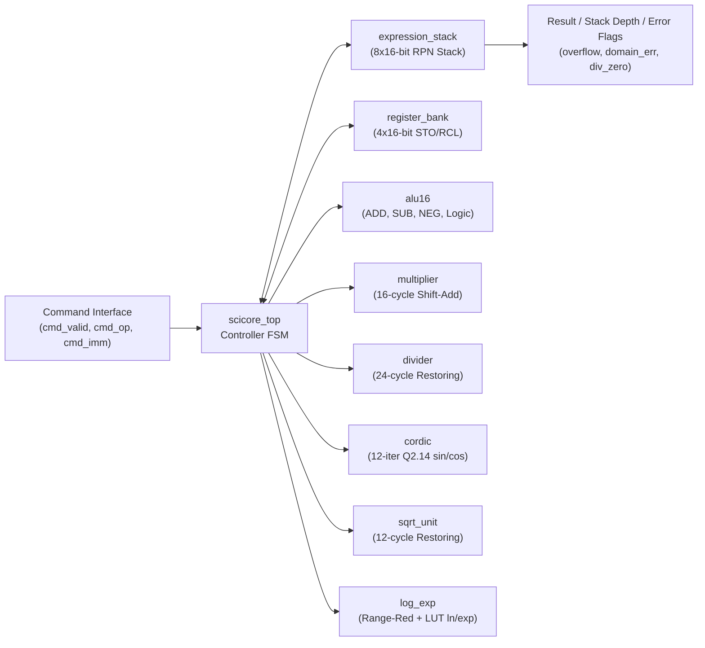

# SciCore-16 — Custom Scientific Calculator ASIC & 2-Layer PCB

A complete **RTL-to-GDSII digital ASIC** and **custom 2-layer KiCad PCB** implementing a 16-bit Q8.8 fixed-point scientific calculator System-on-Chip (SoC), built and verified with a hybrid **SiliconForge (custom VLSI EDA)** + **Yosys / OpenROAD (SkyWater SKY130HD 130 nm)** + **KiCad 10 / ngspice** toolchain.

> **Project Status:** Educational ASIC physical-design and PCB electrical simulation project. Complete SKY130HD GDSII (`6_final.gds`) and DRC-clean routed KiCad Gerbers (`scicore16_pcb_fab.zip`) are included; no silicon fabrication claimed.

---

## Architecture Overview



### Core Capabilities
- **16-bit Signed Q8.8 Fixed-Point Datapath:** Range `[-128.0, +127.996]`, resolution `1/256 ≈ 0.0039`
- **Arithmetic & Scientific Units:**
  - `alu16`: Combinational `ADD`, `SUB`, `AND`, `OR`, `XOR`, `SHL`, `ASR`, `NEG` with signed overflow/zero/negative flags
  - `multiplier`: 16-cycle iterative shift-add multiplier with 32-bit accumulator and round-to-nearest-half-up
  - `divider`: 24-cycle restoring fixed-point divider with 1-cycle divide-by-zero detection and overflow detection
  - `cordic`: 12-iteration rotation-mode circular CORDIC using internal Q2.14 precision (`0 LSB` error across `[-π/2, +π/2]`)
  - `sqrt_unit`: 12-cycle restoring square root with negative-input domain error detection
  - `log_exp`: Binary range-reduction + 16-entry linearly interpolated LUT for `ln(x)` and `exp(x)`
- **RPN Stack Engine & Memory:** 8-deep × 16-bit operand stack (`expression_stack`) + 4×16-bit user registers (`STO`/`RCL`)

---

## Measured Engineering Results

### 1. RTL Verification (SiliconForge Discrete-Event Simulator)
All 5 unit & full-chip testbenches (`tb_m1`, `tb_regbank`, `tb_m2`, `tb_m3`, `tb_m4`, `tb_top`) passed with **0 simulation errors** and VCD waveforms exported under `verification/`:

| End-to-End Test (`tb_top`) | Expected (Q8.8) | Simulated | Error Flags |
| :--- | :---: | :---: | :---: |
| `((3.0 + 5.0) × 2.0) / 4.0` | `0x0400` (`4.000`) | `0x0400` | `000` |
| `sqrt(4.0)` | `0x0200` (`2.000`) | `0x0200` | `000` |
| `sin(π/6) + cos(0)` | `0x0180` (`1.500`) | `0x0180` | `000` |
| `ln(exp(1.0))` | `0x0100` (`1.000`) | `0x0100` | `000` |
| `STO M0 → CLEAR → RCL M0` | `0x0100` (`1.000`) | `0x0100` | `000` |

### 2. Block-Level SCMOS Physical Design (SiliconForge)
| Block | Compacted Dimensions | Area (`λ²`) | Area Reduction | Wirelength | DRC | LVS |
| :--- | :---: | :---: | :---: | :---: | :---: | :---: |
| `alu16` | `1465 × 135 λ` (15 tracks) | `197,775` | **-72.59%** | `16,813 λ` | **0** | **Matched** |
| `register_bank` | `1660 × 321 λ` (40 tracks) | `532,860` | 0.0% | `24,351 λ` | **0** | *Seq. DFF* |
| `multiplier` | `3231 × 240 λ` (30 tracks) | `775,440` | **-82.64%** | `69,900 λ` | **0** | **Matched** |
| `divider` | `5714 × 1098 λ` (151 tracks) | `6,273,972` | 0.0% | `160,858 λ` | **0** | *Seq. DFF* |

### 3. Full-Chip ASIC Physical Design (SkyWater SKY130HD via OpenROAD Flow Scripts)
- **Target Clock:** `10 MHz` (`100 ns` period), `sky130_fd_sc_hd__tt_025C_1v80` (`1.80 V`)
- **Yosys Pre-Map Hierarchy:** `5,263` logic cells, `4,442` wires, **0 inferred latches**
- **Post-Route Area & Utilization:** **`53,041 µm²`** logic area (**44% utilization**; `120,448 µm²` ≈ `0.12 mm²` core)
- **Total Placed Instances:** **19,028** (`601` FFs, `4,538` comb, `203` inv, `176` timing buffers, `138` CTS cells, `1,612` taps, `11,760` fillers)
- **Routing & Signoff:** `167,357 µm` wirelength (`met1–met4`), `43,328` vias, **0 DRC violations**, **0 antenna violations**, **LEC Passed**
- **Power & IR Drop (PDNSim @ 1.80 V):** **`0.710 mW`** total power, **`13.4 µV`** worst-case VDD IR drop (`0.00%`)
- **GDSII Output:** `physical_design/6_final.gds` (`7.65 MB`, all LEF cells matched, 0 orphan cells)

### 4. Custom 2-Layer KiCad PCB & Power Network Simulation
- **Board:** `100 × 75 mm`, 2-layer (`F.Cu` signals/power + continuous `B.Cu` GND plane), 24 footprints (`U1` QFN-64 ASIC, `U2` 3.3 V LDO, `U3` 1.8 V SKY130 Core LDO, `Y1` 10 MHz oscillator, `SW1` reset, `J1–J4` USB/Keypad/SPI LCD/UART headers, decoupling & status LEDs, 4× M3 mounting holes)
- **Routing & DRC:** **30 nets**, **129 copper segments**, **16 vias**, **0 DRC errors**, **0 unconnected items**
- **Power Integrity (`pcb/simulation/power_network.cir`):**
  - `3.3 V` I/O rail: `3.2962 V` steady
  - `1.8 V` Core rail: `1.7994 V` idle → `1.7970 V` under `25 mA` burst (**`2.40 mV` / `0.13%` droop**)
  - RC Power-On Reset (`R1=10 kΩ`, `C6=100 nF`): `RESET_N` releases cleanly at **`0.728 ms`**

---

## Repository Layout

```text
SciCore-16/
├── rtl/
│   ├── arithmetic/   alu16.v, multiplier.v, divider.v, cordic.v, sqrt_unit.v, log_exp.v
│   ├── memory/       register_bank.v, expression_stack.v
│   └── top/          scicore_top.v
├── verification/     tb_m1.v, tb_regbank.v, tb_m2.v, tb_m3.v, tb_m4.v, tb_top.v + *.vcd
├── synthesis/        synth_m1_m2.ys, scicore_top_netlist.v
├── physical_design/  orfs/{config.mk,constraint.sdc}, 6_final.{gds,def,v,spef,sdc,odb}
├── pcb/              scicore16_pcb.kicad_{pro,sch,pcb}, scicore16_pcb_fab.zip, simulation/power_network.cir
├── documentation/    engineering_report.md
└── *.vlsiproj / *.mag (SiliconForge project & SCMOS block layouts)
```

---

## Tools Used
- **SiliconForge** (custom Verilog simulator, synthesizer, SCMOS auto P&R, compaction, DRC/LVS)
- **Yosys** & **OpenROAD Flow Scripts (`openroad/orfs`)** with **SkyWater SKY130HD PDK**
- **KiCad 10.0.6** & **ngspice** (2-layer PCB layout, DRC, Gerber/BOM export, power transient analysis)

See [documentation/engineering_report.md](documentation/engineering_report.md) for the full technical report, validation checklist, and known limitations.
