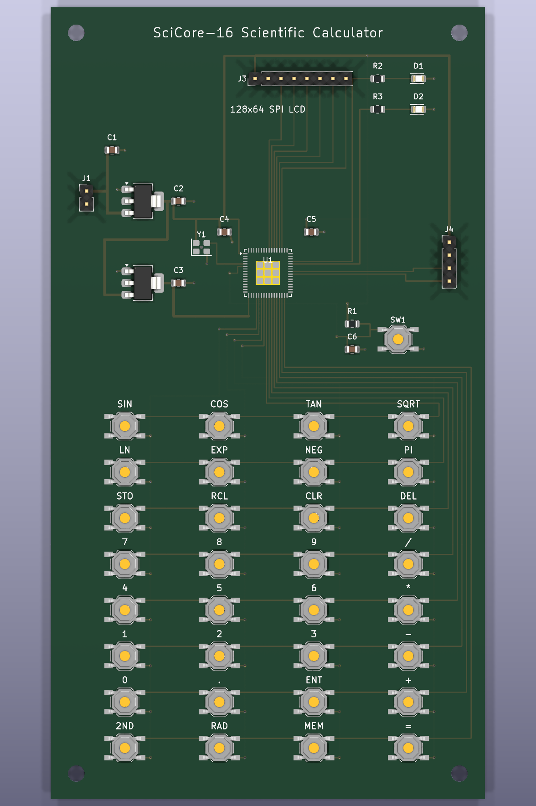
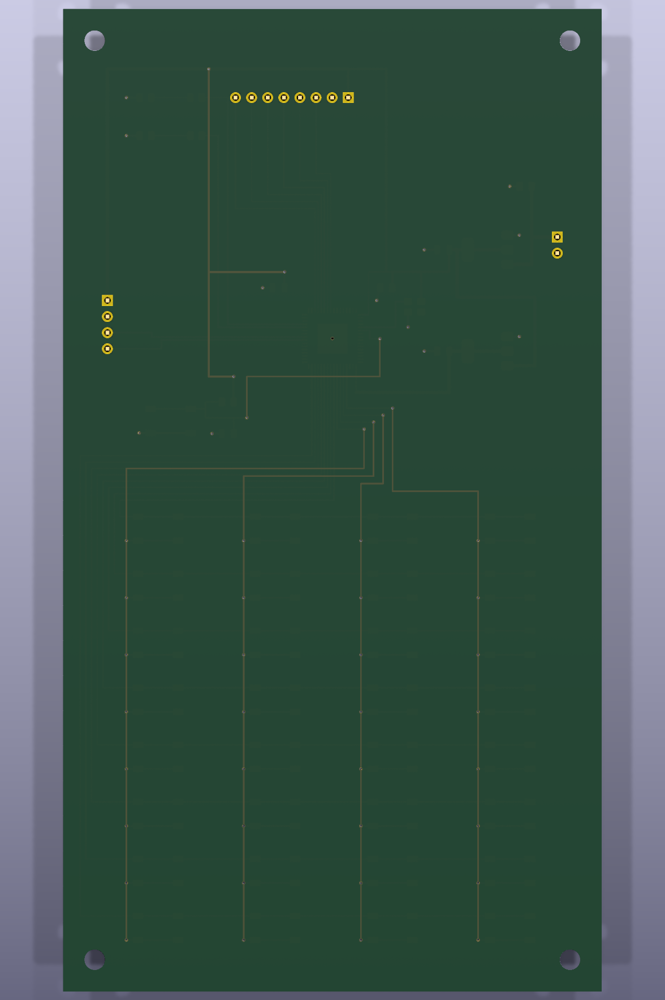
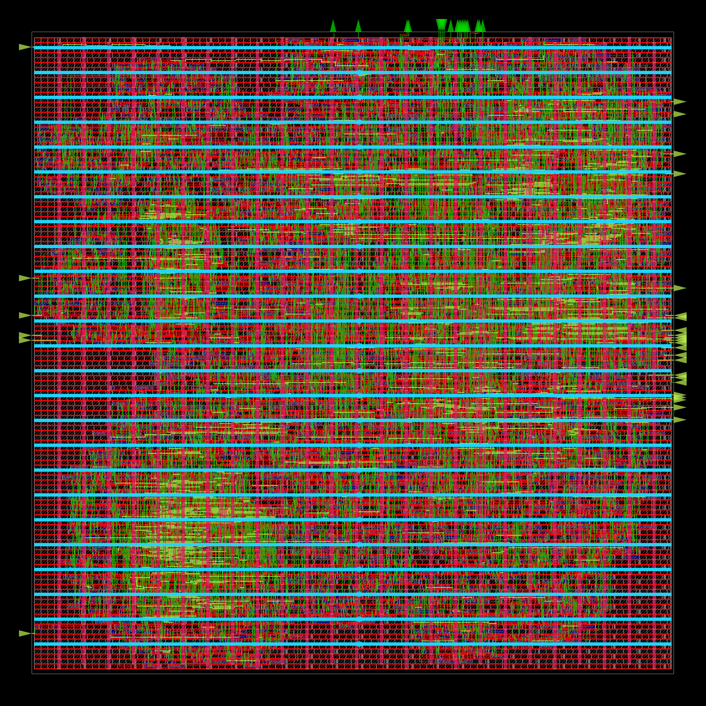
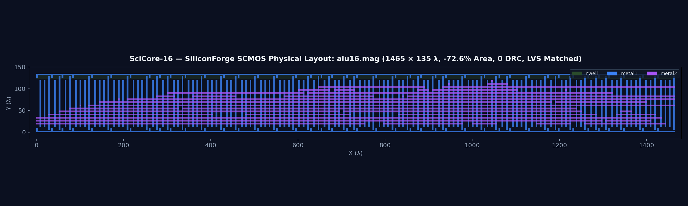
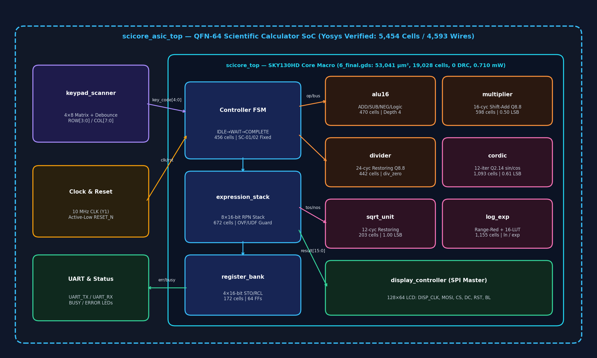
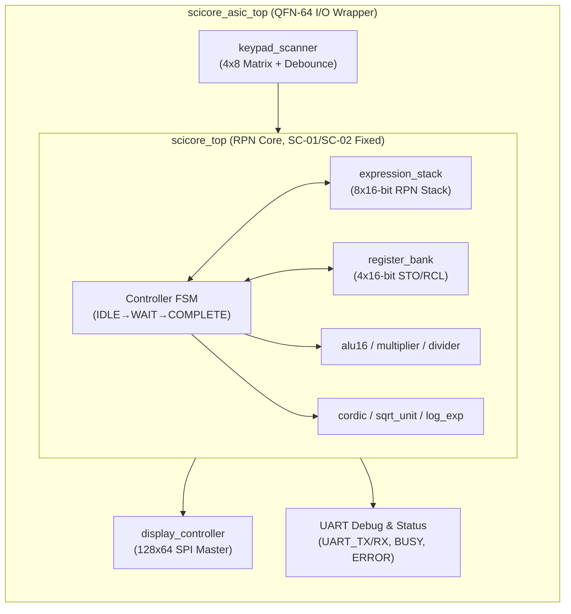

# SciCore-16 (v2.0) — Custom Scientific Calculator ASIC & 2-Layer PCB

A complete **RTL-to-GDSII digital ASIC** and **custom 2-layer KiCad PCB** implementing a 16-bit Q8.8 fixed-point scientific calculator System-on-Chip (SoC), built and verified with **SiliconForge** + **Yosys / OpenROAD (SkyWater SKY130HD 130 nm)** + **KiCad 10 / SPICE**.

> **Project Status:** Educational ASIC physical-design and PCB simulation project. Complete SKY130HD core GDSII (`6_final.gds`), full-chip I/O wrapper (`scicore_asic_top.v`), populated KiCad schematic + DRC-clean routed PCB (`scicore16_pcb_fab.zip`), and exhaustive Python golden-model numerical accuracy data are included. No silicon fabrication or foundry-packaged chip is claimed.

---

## Visual Showcase

### 3D Handheld Calculator PCB (`85 × 155 mm`, 32 Keys, KiCad 10 Raytraced)
| Isometric 3D View | Top 3D View (32-Key Matrix) | Bottom 3D View (`B.Cu` GND & `ROW0–3`) |
| :---: | :---: | :---: |
|  |  |  |

### SKY130HD 130 nm Routed ASIC Layout (OpenROAD — `6_final.odb` / `6_final.gds`)


### SiliconForge SCMOS Block Layout (`alu16.mag` — 0 DRC, LVS Matched)


### Full-Chip IC Architecture & Synthesized Block Schematic (`scicore_asic_top`)


---

## Architecture Overview (v2.0)



### v2.0 Engineering Fixes (Audit Resolution SC-01 → SC-12)
- **SC-01 (`done` handshake timing):** Added dedicated `COMPLETE` FSM state in `scicore_top.v` so `result` (`tos`) and `stack_depth` are committed *before* `done` rises.
- **SC-02 (Stack overflow/underflow protection):** Expanded `err_flags[4:0]` to `{stack_overflow, stack_underflow, div_zero, domain_err, arith_overflow}` and gated all `PUSH`/`RCL`/unary/binary commands before launching arithmetic units.
- **SC-03 (Complete KiCad schematic):** Populated `pcb/scicore16_pcb.kicad_sch` with all 20 component symbols, footprints, and 85 net labels matching the routed PCB 1-to-1.
- **SC-04 (PCB ↔ RTL I/O parity):** Added `rtl/input/keypad_scanner.v`, `rtl/output/display_controller.v`, `rtl/top/scicore_asic_top.v`, and `integration/pin_mapping.csv` matching all 27 active QFN-64 PCB pins.
- **SC-06 / SC-07 / SC-12 (Golden model & numerical sweep):** Added `verification/golden_model.py` (10,000 randomized mul/div tests + exhaustive sweeps of all representable Q8.8 inputs for CORDIC, `sqrt`, `ln`, `exp`) and `documentation/numerical_accuracy_report.md`.
- **SC-08 / SC-09 / SC-10 / SC-11 (Portability & CI):** Portable `SCICORE_ROOT` in `config.mk`, refined `constraint.sdc` (clock uncertainty/transition, output load, false-path reset), `scripts/run_synthesis.sh`, and GitHub Actions CI (`.github/workflows/verification.yml`).

---

## Command Protocol (`scicore_top.v`)
RPN stack commands on `cmd_op[3:0]` (pulsed with `cmd_valid = 1` when `busy == 0`; `result` is guaranteed valid on the cycle `done == 1`):

| `cmd_op` | Mnemonic | Stack Effect | Error Checks |
| :---: | :--- | :--- | :--- |
| `0x0` | `PUSH` | Push `cmd_imm` | `stack_overflow` if `sp == 8` |
| `0x1` | `CLEAR` | `sp <= 0`, clear all `err_flags` | — |
| `0x2` / `0x3` | `ADD` / `SUB` | `nos ± tos` (1 cycle + COMPLETE) | `stack_underflow` (`sp < 2`), `arith_overflow` |
| `0x4` / `0x5` | `MUL` / `DIV` | `nos * tos` (16 cyc) / `nos / tos` (24 cyc) | `stack_underflow`, `div_zero`, `arith_overflow` |
| `0x6` | `NEG` | `-tos` | `stack_underflow` (`sp < 1`), `arith_overflow` |
| `0x7` | `SQRT` | `sqrt(tos)` (12 cyc) | `stack_underflow`, `domain_err` (`tos < 0`) |
| `0x8` / `0x9` | `SIN` / `COS` | `sin(tos)` / `cos(tos)` (12 cyc, `[-π/2, +π/2]`) | `stack_underflow` |
| `0xA` / `0xB` | `LN` / `EXP` | `ln(tos)` / `exp(tos)` | `stack_underflow`, `domain_err` (`x<=0`), `arith_overflow` (`x>4.85`) |
| `0xC` / `0xD` | `STO` / `RCL` | `M[cmd_imm[1:0]] <= tos` / push `M[idx]` | `stack_underflow` / `stack_overflow` |

---

## Measured Results

### 1. Exhaustive Numerical Accuracy (`verification/golden_model.py`, seed `20261120`)
| Unit & Domain | Samples Tested | Max Abs Error | Mean Abs Error | RMS Error | Max Error (Q8.8 LSB) |
| :--- | :---: | :---: | :---: | :---: | :---: |
| `multiplier` (random non-overflow) | 442 / 10,000 | `0.00195` | `0.00094` | `0.00110` | **`0.50 LSB`** |
| `divider` (random non-overflow + `-128/-1`) | 9,966 / 10,000 | `0.00391` | `0.00194` | `0.00224` | **`1.00 LSB`** |
| `cordic sin(x)` (`[-π/2, +π/2]`, exhaustive) | 805 | `0.00238` | `0.00091` | `0.00110` | **`0.61 LSB`** |
| `cordic cos(x)` (`[-π/2, +π/2]`, exhaustive) | 805 | `0.00244` | `0.00090` | `0.00107` | **`0.63 LSB`** |
| `sqrt_unit` (`[0, 127.996]`, exhaustive) | 32,768 | `0.00391` | `0.00196` | `0.00226` | **`1.00 LSB`** |
| `log_exp ln(x)` (`[1/256, 127.996]`, exhaustive) | 32,767 | `0.00648` | `0.00160` | `0.00199` | **`1.66 LSB`** |
| `log_exp exp(x)` (`[-5.55, +4.85]`, exhaustive) | 2,663 | `1.55915` | `0.09743` | `0.24178` | `399.14 LSB` *(~1.2% rel. at 127.7)* |

### 2. Synthesis & ASIC Physical Design
- **Yosys Full-Chip v2.0 (`scicore_asic_top` incl. Keypad + SPI LCD + UART + Core):** **`5,454` cells**, `4,593` wires, **0 errors**
- **SiliconForge Block SCMOS P&R:** `alu16` (`197,775 λ²`, -72.59% area, 0 DRC, LVS matched), `multiplier` (`775,440 λ²`, -82.64% area, 0 DRC, LVS matched)
- **SKY130HD Core Macro (`scicore_top` via OpenROAD Flow Scripts, `10 MHz`, `1.80 V`):**
  - `53,041 µm²` logic area (`44%` utilization; `0.120 mm²` core), `19,028` placed instances, `167,357 µm` wirelength, `43,328` vias
  - **0 detailed-route DRC**, **0 antenna violations**, **LEC Passed**, `6_final.gds` (`7.65 MB`)
  - Vectorless PDNSim IR-drop @ `1.80 V`: `0.710 mW` estimated power, `13.4 µV` worst-case VDD IR drop (`0.00%`)

### 3. Custom 2-Layer Handheld Calculator PCB (`85 × 155 mm`) & Power Simulation
- **Handheld Form Factor:** Portrait calculator layout with 128×64 SPI LCD at top, `SciCore-16` QFN-64 ASIC + dual LDOs (3.3 V / 1.8 V) + 10 MHz osc + UART in middle, and **32 tactile key switches (`K1–K32`, 4×8 matrix) with silkscreen key legends** (`SIN COS TAN SQRT`, `LN EXP NEG PI`, `STO RCL CLR DEL`, `0–9 + − * / . ENT =`) across the lower keypad zone
- **Schematic + Routed Layout:** 51 components + 4× M3 mounting holes, 30 routed nets, **296 copper segments**, **54 vias**, `B.Cu` GND plane under electronics
- **KiCad DRC:** **0 DRC errors**, **0 unconnected items**
- **Simplified Behavioral Power Network Simulation (`pcb/simulation/power_network.cir`):** `3.2962 V` I/O rail, `1.7994 V` core idle → `1.7970 V` under `25 mA` burst (`2.40 mV` / `0.13%` droop), `RESET_N` releases at `0.728 ms`

---

## Reproducing Checks
```bash
# 1. Exhaustive Python golden model & numerical accuracy report
python3 verification/golden_model.py

# 2. Full-chip Yosys synthesis (scicore_asic_top)
bash scripts/run_synthesis.sh

# 3. SKY130HD RTL-to-GDSII (OpenROAD Flow Scripts Docker)
docker run --rm -v "$(pwd):/work" openroad/orfs:latest \
  make -C /OpenROAD-flow-scripts/flow DESIGN_CONFIG=/work/physical_design/orfs/config.mk
```

See [documentation/engineering_report.md](documentation/engineering_report.md), [documentation/numerical_accuracy_report.md](documentation/numerical_accuracy_report.md), and [integration/pin_mapping.csv](integration/pin_mapping.csv) for full details.
